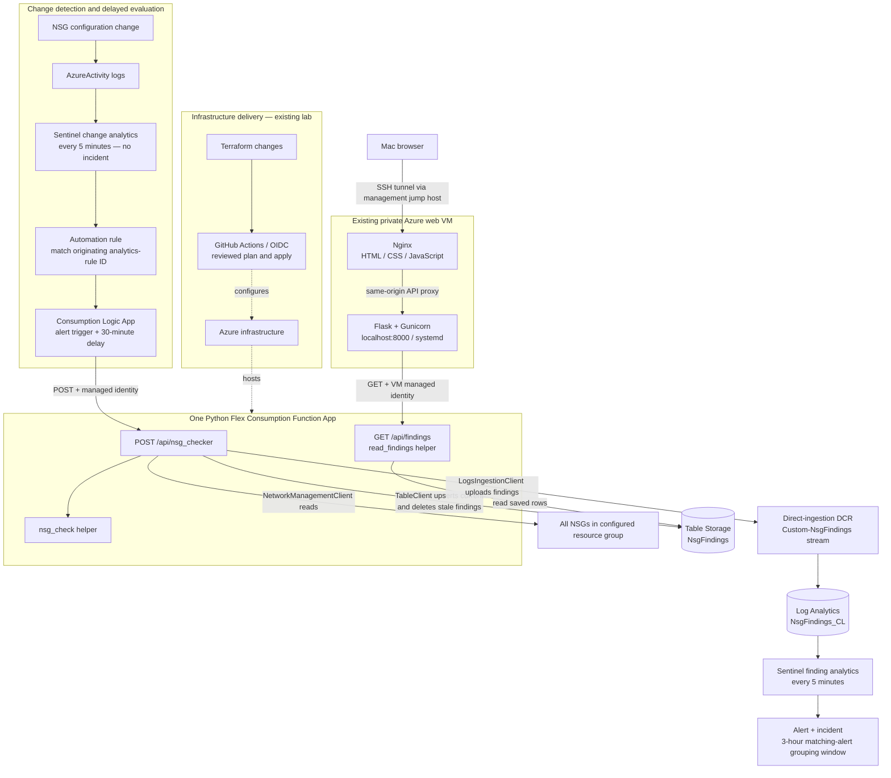

# Azure NSG Security Automation

**Python SDK · Terraform · Managed Identity · Microsoft Sentinel**

I built an Azure security workflow that turns an NSG configuration change into a
delayed configuration check, a saved finding, and a Sentinel incident when an
unrestricted-source SSH allow rule is detected. A private dashboard displays the
saved results without exposing Azure credentials to the browser.

My focus was learning to use the **Azure SDK for Python**, manage the supporting
resources with **Terraform**, and connect identity, networking, storage, and
monitoring into a working security solution. The UI is a supporting component.

**Status:** live lab validation completed October 25, 2026. This is a portfolio
lab, not a production security product or an automatic remediation system.

[Architecture](#architecture) · [Python implementation](#python-sdk-implementation) ·
[Design decisions](#why-i-built-it-this-way) · [Evidence](#verified-results) ·
[Setup guide](docs/deployment.md) · [Troubleshooting](docs/troubleshooting.md)


## The problem and goals

An NSG write event tells me that configuration changed; it does not tell me whether
the resulting configuration is risky. Creating an incident for every edit would
mix routine administration with changes that need investigation.

I wanted to:

- Inspect actual Azure rule objects with Python SDK clients instead of judging a change notification alone.
- Separate **change detection** from **risk evaluation** and incident creation.
- Recheck configuration after a 30-minute grace period.
- Use managed identities for deployed service access instead of stored keys.
- Make current saved findings available to a dashboard and send detection events to Sentinel.
- Manage infrastructure changes through Terraform and reviewed plans.
- Troubleshoot the integrations and understand why each component is present.

This extends my [Azure Infrastructure Security Lab](https://github.com/Anthonydeangelis/Azure-Infra-Security-Lab),
which supplies the networks, VMs, workspace, and Terraform deployment workflow.
This repository presents the project-specific Python, frontend, selected
infrastructure snippets, and engineering notes.

## What this demonstrates

| Area | Work demonstrated |
| --- | --- |
| Python SDKs | Enumerating NSGs/rules, iterating SDK results, inspecting model properties, evaluating rules, writing entities, and uploading structured logs |
| Terraform | AzureRM resources and ARM templates; dependencies, outputs, app settings, reviewed plans, and drift correction |
| Cloud identity | Local CLI versus deployed managed identity; resource RBAC versus API authorization; client IDs versus principal IDs |
| Security automation | KQL, Sentinel automation routing, delayed Logic App evaluation, and separate finding-based incidents |
| Networking and APIs | Jump-host access, SSH forwarding, Nginx proxying, and a managed-identity-authenticated API |
| Troubleshooting | Protocol capitalization, runtime storage configuration, and Terraform reverting portal authentication changes |

## Architecture



The Function App validates incoming Entra tokens. Its own managed identity is a
different identity used for outbound access to NSGs, Storage, and ingestion.
The dashboard backend keeps its Azure token on the VM.

### How one change becomes a finding

1. A successful NSG/rule write or rule deletion is recorded in `AzureActivity`.
2. The first scheduled Sentinel rule creates a configuration-change **alert**.
3. Automation matches the alert's originating analytics-rule ID—not its title—and starts `NSG-change`.
4. The Logic App waits 30 minutes and calls the checker using managed identity.
5. The checker scans **all NSGs in the configured resource group**, not only the changed rule.
6. After the entire read/evaluation phase succeeds, it saves current findings and deletes stale findings in that scope.
7. Matching findings are also uploaded through the DCR to `NsgFindings_CL`.
8. A second Sentinel rule creates an alert and incident from newly ingested risky findings.
9. The dashboard retrieves Storage results when opened or refreshed. Refresh does **not** start a scan.

Thirty minutes is the workflow delay, not an end-to-end SLA. Ingestion, both
analytics schedules, and processing add latency.

## Python SDK implementation

My working model was **authenticate → client → operation group → method → returned properties**.

```python
client = NetworkManagementClient(cred, sub_id)

for nsg in client.network_security_groups.list(rg):
    for rule in client.security_rules.list(rg, nsg.name):
        if nsg_check(rule):
            # Collect the finding for persistence and ingestion.
            ...
```

| Package | Use |
| --- | --- |
| `azure-identity` | `AzureCliCredential` locally; explicit `ManagedIdentityCredential` in Azure |
| `azure-mgmt-network` | Read NSGs and custom security rules with `NetworkManagementClient` |
| `azure-data-tables` | Upsert/query entities, delete stale records, and read saved findings |
| `azure-monitor-ingestion` | Send schema-matched events through the DCR with `LogsIngestionClient` |
| `azure-functions` | Expose the checker and reader HTTP functions |

### What counts as a finding

All conditions must match:

| Property | Condition |
| --- | --- |
| Access / direction | `Allow` and `Inbound` |
| Protocol | TCP, normalized for capitalization, or `*` |
| Destination port | `22`, `*`, or an inclusive range containing 22 |
| Source | `*`, `0.0.0.0/0`, `::/0`, or the `Internet` service tag |

The helper handles singular and plural destination-port and source-address fields.
A specific public `/32` is outside this unrestricted-source check. This is not a
general public-CIDR classifier or effective-rule/priority evaluation engine.
The finding does **not prove live reachability**: NSG associations, higher-priority
rules, routing, public addresses, and host controls also affect access.

### Two HTTP functions, one Function App

| Endpoint | Intended caller | Behavior |
| --- | --- | --- |
| `POST /api/nsg_checker` | Logic App | Scan, reconcile Storage, upload risky findings, return status/count |
| `GET /api/findings` | VM backend | Read saved rows and return JSON; no new scan |

`nsg_check()` and `read_findings()` are ordinary Python helpers, not separate
Function Apps. Exceptions return an error rather than a successful zero-finding scan.

### Snapshot storage versus detection events

`NsgFindings` holds saved dashboard findings. Stable SHA-256 keys derived from the
normalized NSG ID and rule/check identity avoid invalid key characters and let
repeated scans update the same row. Hashing is not encryption. After a complete
scan, stale rows in scope are removed; a successful zero-finding scan clears
previous SSH findings. The connectivity-test row is excluded by the check filter.

`NsgFindings_CL` is a separate append-only detection log. Python explicitly sends
events through the DCR. **Storage diagnostic settings do not copy entity contents
into Log Analytics.** Removing a Storage row does not remove logs or close incidents.

## Why I built it this way

| Decision | Reason and trade-off |
| --- | --- |
| Two analytics rules | Routine edits trigger evaluation; only matching risks create project risk incidents. This adds a second scheduling stage. |
| 30-minute delay | Allows time to correct temporary changes before evaluation; deliberately delays detection. |
| Resource-group-wide scan | One view across the lab; more repeated work per change. |
| Flex Consumption Functions | On-demand Python execution fits the HTTP-triggered workload. |
| Managed identity | Avoids stored service credentials and separates inbound API authorization from outbound RBAC. |
| User-assigned Function identity | Could exist and receive Storage permissions before the Function App was created. |
| Terraform with ARM templates | Reviewable configuration while expressing detailed workflow, table, and DCR schemas through AzureRM. |
| Two storage destinations | The dashboard needs saved current results; Sentinel needs detection events with a different lifecycle. |
| Reader API | Centralizes table access and gives clients a reusable endpoint. Direct VM-to-Storage access would remove a hop but move that logic and access into the VM. |
| Existing private Nginx VM | Reuses the lab; backend authentication keeps Azure tokens out of the browser. Adds a service to maintain. |
| No automatic remediation | Keeps the learning scope controlled and avoids automatically changing real management access. |

See [architecture and identity details](docs/architecture.md) for boundaries and permissions.

## Verified results

These are actual lab screenshots from October 25, 2026, not mock data. They show
**different stages/runs**: the earlier ingestion and incident used `test_ssh-01`;
the replacement test used `test-ssh-internet`.

### Structured finding in Log Analytics


This verified the checker → ingestion SDK → DCR → workspace path, including NSG,
rule, status, reason, and observation time.

### Sentinel incident with the NSG mapped as an asset


Incident 14 demonstrates the earlier finding creating a Medium-severity incident.
It is not evidence that the later renamed rule created that same incident.

### Replacement finding in the dashboard

The screenshot at the top shows `test-ssh-internet` after replacing the old rule.
Only the replacement finding is shown. This verified upsert/stale-row cleanup and
the dashboard's authenticated read path after correcting Terraform authentication drift.

See the [validation record](docs/validation.md) for test steps and remaining unverified cases.

## Build and run

Use the [deployment walkthrough](docs/deployment.md) and [dashboard guide](dashboard/README.md).

**Repository boundary:** `Terraform/` contains selected snippets from the existing
lab, not a standalone Terraform root. Some definitions overlap and some workflow
examples predate the deployed delay/HTTP action. Do **not** run `terraform apply`
against this directory or copy every file together. Final live changes were
applied in the owning infrastructure repository. This is not a one-command deployment.

```text
Python/functions/       HTTP functions, evaluator and reader helpers
Terraform/             Selected snippets and earlier workflow examples
dashboard/dist/        Static HTML, CSS and JavaScript
dashboard/backend/     VM backend reference matching the tested design
dashboard/deployment/  Nginx and systemd reference configurations
docs/architecture.md   Infrastructure, identities and data contracts
docs/deployment.md     Build sequence and required settings
docs/validation.md     Evidence, test steps and publication checklist
docs/troubleshooting.md Root causes and fixes
docs/images/           Lab screenshots
PROJECT_PLAN.md        Archived initial proposal, not the final implementation
```

## Lessons learned

- **Inspect API values.** Azure returned `TCP`; comparing it with `Tcp` caused a false negative.
- **Portal fixes can drift.** Adding a caller in the portal worked until Terraform restored its allowlist. Both identities needed to be represented in IaC.
- **Authentication has layers.** Route `ANONYMOUS` removes the function-key requirement; platform Entra authentication must still require and authorize tokens. Storage RBAC is a separate check.
- **Resource existence is not runtime health.** A malformed storage connection setting prevented the function host from starting.
- **Verify each hop.** HTTP success, a Storage entity, an ingested log, an incident, and the dashboard are different checkpoints.

See [troubleshooting](docs/troubleshooting.md) for the concrete failures and fixes.

## Scope and known limitations

- Resource-group scope and custom rules; unrestricted-source SSH only. No RDP, broader CIDR analysis, remediation, or live reachability testing.
- Multiple change alerts can start overlapping delayed runs. This was observed; concurrency controls are deferred. Reconciliation is not atomic and scans can race.
- Persistence and ingestion are not one transaction. Failures can leave partial writes; completed Storage writes are not rolled back after ingestion errors.
- Each matching scan appends log events. Three-hour grouping reduces repeats; it is not exactly-once delivery or one incident forever.
- Queries use a one-hour event lookback and five-minute ingestion filter. Scheduling/ingestion gaps need further reliability testing.
- Findings describe scan-time configuration. Incidents are not automatically closed when a rule is fixed. The dashboard has no separate last-successful-scan record.
- Entra allowlists apply across the Function App. The VM is not restricted to the reader route by per-route authorization.
- The dashboard is private lab tooling, not a public authenticated website. Identity-protected Azure service endpoints are not equivalent to a private-endpoint deployment.

## AI assistance and references

I used AI as a tool during implementation and troubleshooting. The dashboard's
HTML, CSS, and JavaScript were AI-generated; frontend design was not the portion
I focused on learning. My focus was the Python SDK workflow, Terraform, Azure
identity/networking, and security automation. AI also assisted with supporting
code and documentation; this is not a claim that every line was written unaided.

README organization was informed by the component/prerequisite sections in
[Azure's managed-identity Functions sample](https://github.com/Azure-Samples/functions-apim-managed-identity),
the setup/architecture walkthrough in [Azure's Python Functions sample](https://github.com/Azure-Samples/functions-quickstart-python-azd-service-bus),
and the separation of claims from evidence in
[Azure Zero Trust Reference Architectures](https://github.com/mhartson310/Azure-Zero-Trust-Reference-Architectures).
These were structural references, not sources of implementation code.

Before publishing, review screenshots and tracked files and regenerate exposed
test credentials. Use the [publication checklist](docs/validation.md#before-making-the-repository-public).
