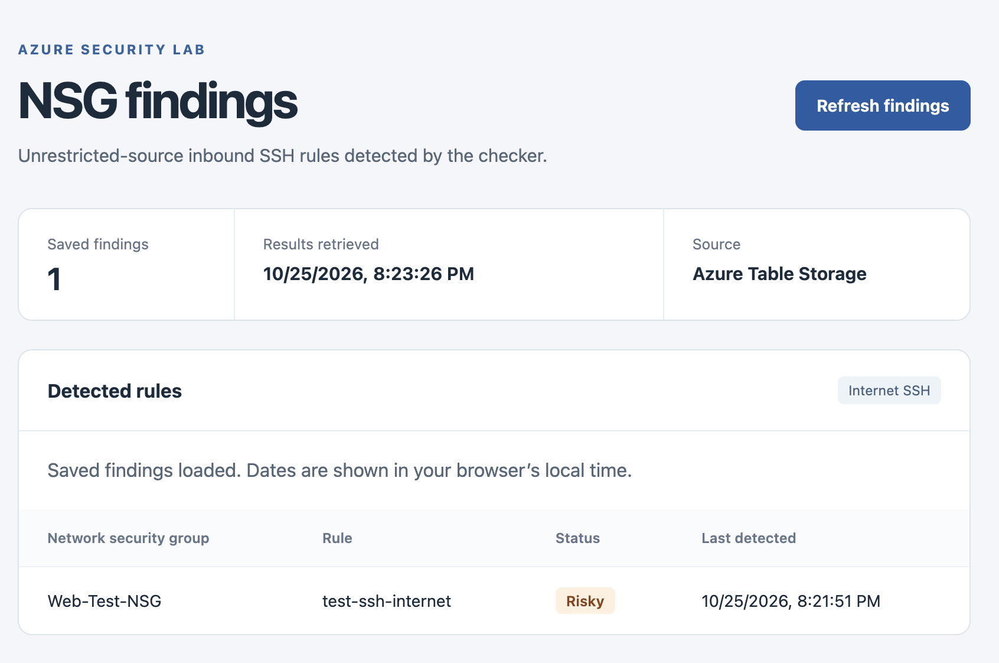
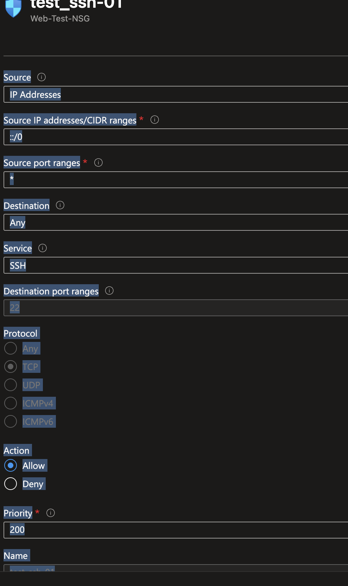
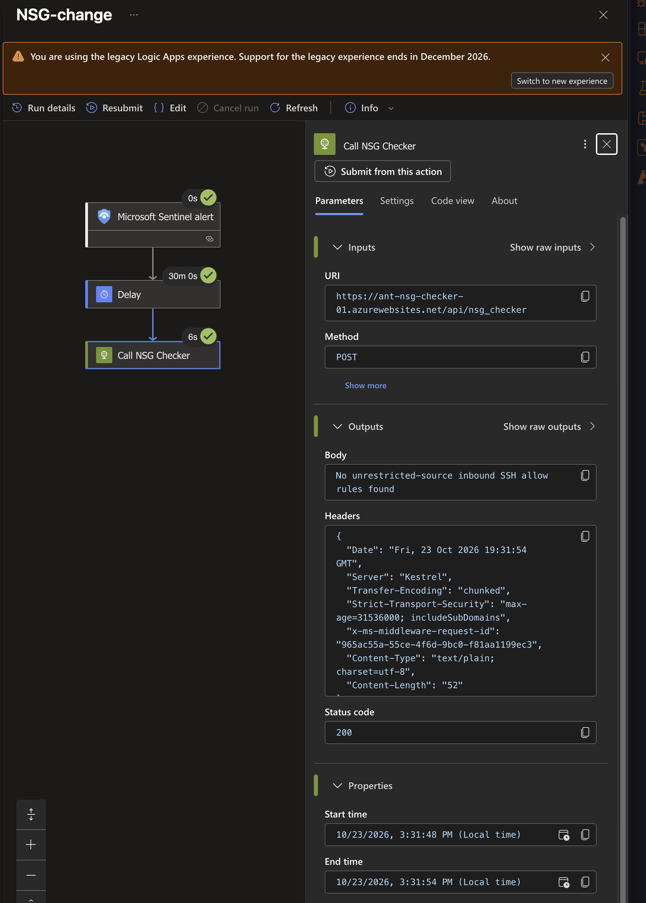
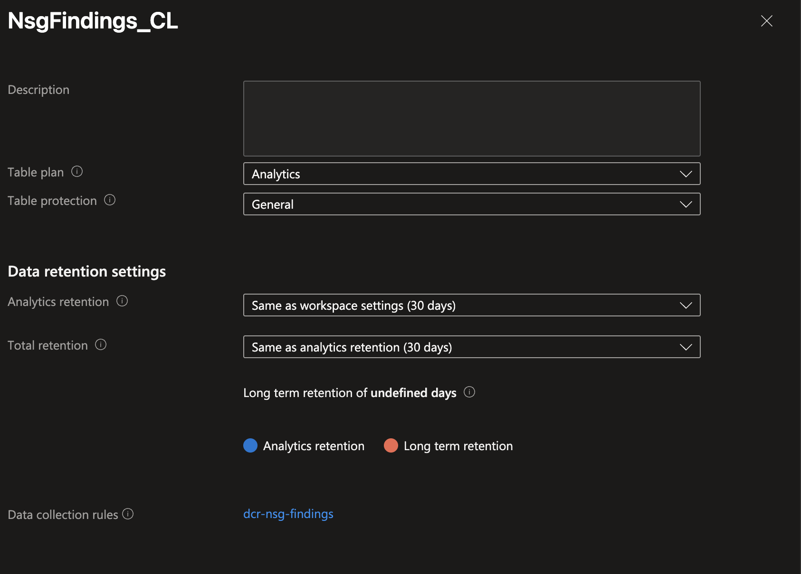
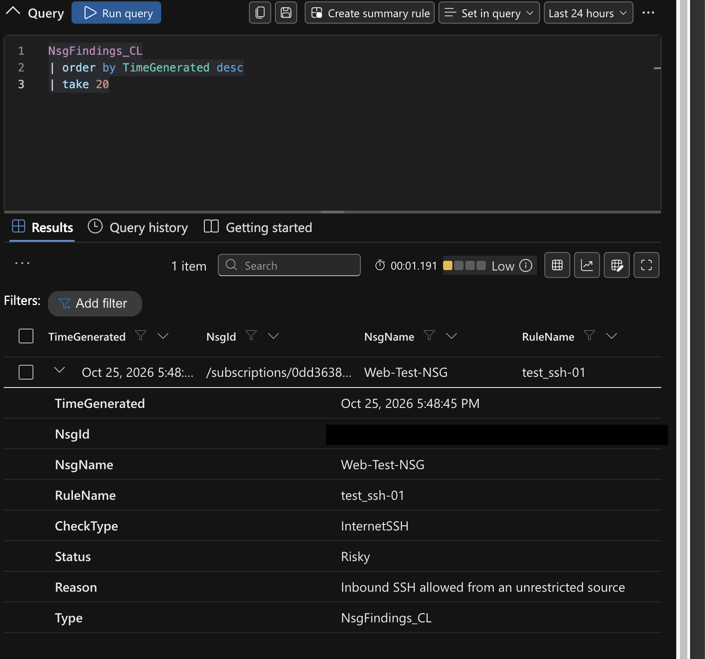
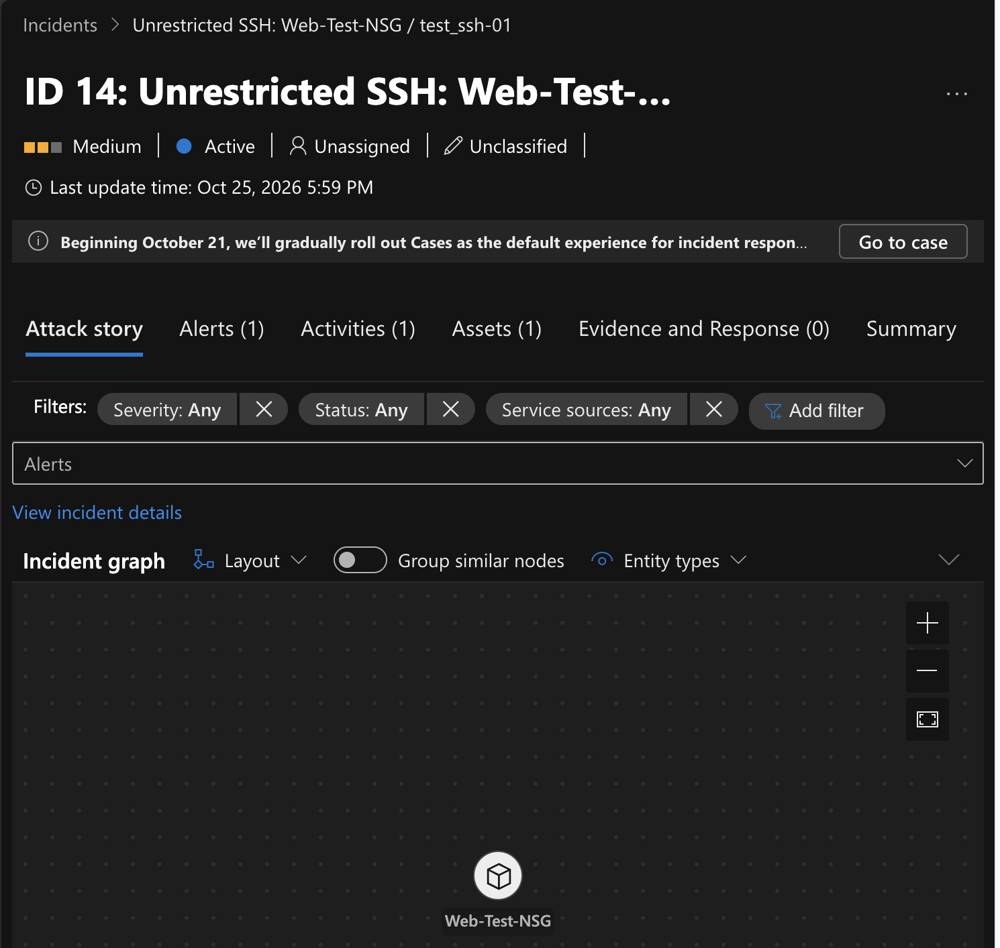

# Azure NSG Security Automation

**From an NSG change to Python evaluation, a Sentinel incident, and a private findings dashboard.**

Python SDK · Terraform · Managed Identity · Microsoft Sentinel

I built an Azure security workflow that turns an NSG configuration change into a
delayed configuration check, a saved finding, and a Sentinel incident when an
unrestricted-source SSH allow rule is detected. A private dashboard displays the
saved results without exposing Azure credentials to the browser.

My focus was learning to use the **Azure SDK for Python**, manage the supporting
resources with **Terraform**, and connect identity, networking, storage, and
monitoring into a working security solution. The UI is a supporting component.

**Verified through October 25, 2026:** a controlled unrestricted-source SSH rule produced
an ingested finding and Sentinel incident. A later rule replacement removed the old
saved finding and displayed the new one on the private dashboard. This is a learning
lab, not automatic remediation.

[Verified results](#verified-results) · [Architecture](#architecture) ·
[Python implementation](#python-sdk-implementation) · [Build and evidence](#build-and-evidence) ·
[Lessons learned](#lessons-learned) · [Getting started](#getting-started)



## The problem and goals

An NSG write event tells me that configuration changed; it does not tell me whether
the resulting configuration is risky. Creating an incident for every edit would
mix routine administration with changes that need investigation.

I wanted to:

- Inspect actual Azure rule objects with Python SDK clients instead of judging a change notification alone.
- Separate **change detection** from **risk evaluation** and incident creation.
- Recheck configuration after a 30-minute grace period.
- Use managed identities for deployed service access instead of stored keys.
- Make current saved findings available to a dashboard and send detection events to Sentinel.
- Manage infrastructure changes through Terraform and reviewed plans.
- Troubleshoot the integrations and understand why each component is present.

This extends my [Azure Infrastructure Security Lab](https://github.com/Anthonydeangelis/Azure-Infra-Security-Lab),
which supplies the networks, VMs, workspace, and Terraform deployment workflow.
This repository presents the project-specific Python, frontend, selected
infrastructure snippets, and engineering notes.

In the base lab, NSG edits were themselves a detection scenario. This project adds
an evaluation layer: **the first change alert starts a delayed check; the second
finding alert creates the risk incident**. It reuses the base lab rather than
claiming its networking, VMs, and CI workflow were all built again here.

## What this demonstrates

| Area | Work demonstrated |
| --- | --- |
| Python SDKs | Enumerating NSGs/rules, iterating SDK results, inspecting model properties, evaluating rules, writing entities, and uploading structured logs |
| Terraform | AzureRM resources and ARM templates; dependencies, outputs, app settings, reviewed plans, and drift correction |
| Cloud identity | Local CLI versus deployed managed identity; resource RBAC versus API authorization; client IDs versus principal IDs |
| Security automation | KQL, Sentinel automation routing, delayed Logic App evaluation, and separate finding-based incidents |
| Networking and APIs | Jump-host access, SSH forwarding, Nginx proxying, and a managed-identity-authenticated API |
| Troubleshooting | Protocol capitalization, runtime storage configuration, and Terraform reverting portal authentication changes |


## Features

- Resource-group-wide NSG inspection through the Azure SDK for Python.
- Separate helpers for SSH ports, unrestricted sources, and rule evaluation.
- Sentinel alert routing into a 30-minute delayed Logic App check.
- Managed-identity access for Azure resource reads, Table writes, log ingestion, and the VM-to-API call.
- Latest saved findings in Table Storage, with stale-row cleanup after successful scans.
- Explicit DCR ingestion and finding-based Sentinel incidents.
- A read-only private Nginx dashboard with Azure tokens kept on the VM backend.

## Tech stack

| Area | Tools |
| --- | --- |
| Python evaluation | Python 3.14 Function runtime, Azure Identity, Network Management, Tables, and Monitor Ingestion SDKs |
| Infrastructure | Terraform 1.16.4, AzureRM 5.0.0, ARM templates through AzureRM |
| Runtime and storage | Linux Flex Consumption Functions, FC1 plan, StorageV2, Blob deployment container, Table Storage |
| Detection and orchestration | AzureActivity, KQL, Microsoft Sentinel, Consumption Logic Apps, Direct DCR, Log Analytics |
| Identity | Entra API authentication, user-assigned Function identity, system-assigned Logic App and VM identities |
| Presentation | Existing Ubuntu web VM, Nginx, Flask, Gunicorn, systemd, HTML/CSS/JavaScript |
| Access and delivery | Management jump host, SSH tunnel, existing lab GitHub Actions OIDC and reviewed-plan apply |

Versions above are declared in the owning lab's
[provider configuration](https://github.com/Anthonydeangelis/Azure-Infra-Security-Lab/blob/main/Terraform/providers.tf);
they are not a new clean-environment validation of this portfolio.

## Verified results

| Controlled test / milestone | Observed outcome | Evidence |
| --- | --- | --- |
| Sentinel alert starts the delayed workflow | Trigger, 30-minute Wait, and checker POST succeeded; earlier no-finding text response | [Completed run](docs/images/logic-app-delay-completed.png) |
| Evaluate the initial IPv6 SSH test rule | After normalizing protocol capitalization, a risky finding reached the custom log | [Rule input](docs/images/test-rule-ipv6.png) / [ingested finding](docs/images/log-analytics-finding.png) |
| Route Python findings through the DCR | Custom table linked to the DCR; actual record queried in Log Analytics | [Table configuration](docs/images/custom-table-dcr.png) / [record](docs/images/log-analytics-finding.png) |
| Detect an ingested risky finding | Sentinel incident 14, Medium severity, one alert, NSG asset | [Incident](docs/images/sentinel-incident.png) |
| Replace the test rule through the owning Terraform configuration | Old saved finding removed; `test-ssh-internet` displayed instead | [Dashboard](docs/images/dashboard-internet-ssh.png) |
| Restore VM API access after Terraform drift | Both caller identities retained in configuration and dashboard retrieval restored | [Current Terraform](Terraform/reference/Nsg-proj.tf.example) / [dashboard](docs/images/dashboard-internet-ssh.png) |

These are checkpoints from **different runs on October 23–25**, not a single run
with one rule name. The workflow screenshot predates JSON persistence; incident
14 belongs to `test_ssh-01`, not the later replacement. The
[validation record](docs/validation.md) distinguishes live evidence from local checks
and tests that remain outstanding.

## Architecture


The Function App validates incoming Entra tokens. Its own managed identity is a
different identity used for outbound access to NSGs, Storage, and ingestion.
The dashboard backend keeps its Azure token on the VM.

### How one change becomes a finding

1. A successful NSG/rule write or rule deletion is recorded in `AzureActivity`.
2. The first scheduled Sentinel rule creates a configuration-change **alert**.
3. Automation matches the alert's originating analytics-rule ID—not its title—and starts `NSG-change`.
4. The Logic App waits 30 minutes and calls the checker using managed identity.
5. The checker scans **all NSGs in the configured resource group**, not only the changed rule.
6. After the entire read/evaluation phase succeeds, it saves current findings and deletes stale findings in that scope.
7. Matching findings are also uploaded through the DCR to `NsgFindings_CL`.
8. A second Sentinel rule creates an alert and incident from newly ingested risky findings.
9. The dashboard retrieves Storage results when opened or refreshed. Refresh does **not** start a scan.

Thirty minutes is the workflow delay, not an end-to-end SLA. Ingestion, both
analytics schedules, and processing add latency.

## How I built toward the goal

I built and checked the system in small stages rather than beginning with the dashboard.
The [screenshot-led build story](docs/build-story.md) follows each step with
**what I did, why I chose it, the relevant code, and what the evidence establishes**.

| Stage | Why it mattered | Inspect the work |
| --- | --- | --- |
| SDK reads and evaluator | Learn the returned rule properties and define a clear risk condition before automating it | [Python helper](Python/functions/nsg.py), [test input and protocol fix](docs/build-story.md#2-define-a-small-explainable-risk-check) |
| Function hosting and identity | Run the Python on demand without relying on my local CLI login | [HTTP implementation](Python/functions/function_app.py), [identity decisions](docs/build-story.md#3-move-the-checker-into-azure-functions-and-replace-local-credentials) |
| Terraform and delayed orchestration | Make configuration reviewable and distinguish a change notification from evaluated risk | [IaC evidence map](Terraform/README.md), [completed workflow screenshot](docs/build-story.md#5-separate-change-detection-from-risk-escalation) |
| Table SDK persistence | Let repeat scans update findings and remove stale rows instead of accumulating duplicates | [snapshot reasoning](docs/build-story.md#6-save-findings-as-a-current-snapshot) |
| Logs ingestion and incidents | Send explicit structured findings to the SIEM rather than treating Storage diagnostics as entity ingestion | [DCR, log, and incident evidence](docs/build-story.md#7-send-detection-events-explicitly-into-log-analytics) |
| Private presentation path | Display saved results while keeping tokens on the VM and the page behind private access | [reader](Python/functions/findings_reader.py), [final validation](docs/build-story.md#10-verify-replacement-cleanup-and-the-presentation-path) |

## Python SDK implementation

My working model was **authenticate → client → operation group → method → returned properties**.

```python
client = NetworkManagementClient(cred, sub_id)

for nsg in client.network_security_groups.list(rg):
    for rule in client.security_rules.list(rg, nsg.name):
        if nsg_check(rule):
            # Collect the finding for persistence and ingestion.
            ...
```

| Package | Use |
| --- | --- |
| `azure-identity` | `AzureCliCredential` locally; explicit `ManagedIdentityCredential` in Azure |
| `azure-mgmt-network` | Read NSGs and custom security rules with `NetworkManagementClient` |
| `azure-data-tables` | Upsert/query entities, delete stale records, and read saved findings |
| `azure-monitor-ingestion` | Send schema-matched events through the DCR with `LogsIngestionClient` |
| `azure-functions` | Expose the checker and reader HTTP functions |

### What counts as a finding

All conditions must match:

| Property | Condition |
| --- | --- |
| Access / direction | `Allow` and `Inbound` |
| Protocol | TCP, normalized for capitalization, or `*` |
| Destination port | `22`, `*`, or an inclusive range containing 22 |
| Source | `*`, `0.0.0.0/0`, `::/0`, or the `Internet` service tag |

The helper handles singular and plural destination-port and source-address fields.
A specific public `/32` is outside this unrestricted-source check. This is not a
general public-CIDR classifier or effective-rule/priority evaluation engine.
The finding does **not prove live reachability**: NSG associations, higher-priority
rules, routing, public addresses, and host controls also affect access.

### Two HTTP functions, one Function App

| Endpoint | Intended caller | Behavior |
| --- | --- | --- |
| `POST /api/nsg_checker` | Logic App | Scan, reconcile Storage, upload risky findings, return status/count |
| `GET /api/findings` | VM backend | Read saved rows and return JSON; no new scan |

`nsg_check()` and `read_findings()` are ordinary Python helpers, not separate
Function Apps. Exceptions return an error rather than a successful zero-finding scan.

### Snapshot storage versus detection events

`NsgFindings` holds saved dashboard findings. Stable SHA-256 keys derived from the
normalized NSG ID and rule/check identity avoid invalid key characters and let
repeated scans update the same row. Hashing is not encryption. After a complete
scan, stale rows in scope are removed; a successful zero-finding scan clears
previous SSH findings. The connectivity-test row is excluded by the check filter.

`NsgFindings_CL` is a separate append-only detection log. Python explicitly sends
events through the DCR. **Storage diagnostic settings do not copy entity contents
into Log Analytics.** Removing a Storage row does not remove logs or close incidents.

## Why I built it this way

| Decision | Reason and trade-off |
| --- | --- |
| Two analytics rules | Routine edits trigger evaluation; only matching risks create project risk incidents. This adds a second scheduling stage. |
| 30-minute delay | Allows time to correct temporary changes before evaluation; deliberately delays detection. |
| Resource-group-wide scan | One view across the lab; more repeated work per change. |
| Flex Consumption Functions | On-demand Python execution fits the HTTP-triggered workload. |
| Managed identity | Avoids stored service credentials and separates inbound API authorization from outbound RBAC. |
| User-assigned Function identity | Could exist and receive Storage permissions before the Function App was created. |
| Terraform with ARM templates | Reviewable configuration while expressing detailed workflow, table, and DCR schemas through AzureRM. |
| Two storage destinations | The dashboard needs saved current results; Sentinel needs detection events with a different lifecycle. |
| Reader API | Centralizes table access and gives clients a reusable endpoint. Direct VM-to-Storage access would remove a hop but move that logic and access into the VM. |
| Existing private Nginx VM | Reuses the lab; backend authentication keeps Azure tokens out of the browser. Adds a service to maintain. |
| No automatic remediation | Keeps the learning scope controlled and avoids automatically changing real management access. |

See [architecture and identity details](docs/architecture.md) for boundaries and permissions.

## Build and evidence

I developed the project in stages so each SDK call, permission, and service
boundary could be checked before adding the next integration. The
[full build story](docs/build-story.md) pairs each stage with **what I did, why,
the relevant code, and what its screenshot proves**.

### Python evaluation and delayed orchestration

I started with local NSG reads and a small rule evaluator, then hosted the checker
in Functions with managed identity. Change alerts start evaluation, not immediate
risk incidents. The 30-minute delay is an intentional grace period, not a claim
that the pipeline completes in exactly 30 minutes.

<details>
<summary>View the test input and completed delayed workflow</summary>



The editor shows the earlier IPv6 test input. CLI readback separately confirmed
the saved inbound rule. The image alone does not prove attachment state or reachability.



This October 23 run returned HTTP 200 with a plain-text no-findings response.
It proves the orchestration step, not the later Table/JSON/ingestion implementation.

</details>

[Evaluator](Python/functions/nsg.py) · [HTTP functions](Python/functions/function_app.py) · [Protocol debugging](docs/troubleshooting.md)

### Terraform, structured ingestion, and Sentinel incidents

I used the owning lab's Terraform workflow for the supporting resources and
configuration. The current project snapshot shows the final workflow, Function
hosting and identity settings, custom table schema, DCR routing/outputs, and the
finding analytics rule. Python sends finding events explicitly; Storage
diagnostics do not copy entity contents to the workspace.

<details>
<summary>View DCR/table configuration, the ingested record, and the incident</summary>



This confirms the configured destination. It does not alone prove data ingestion.



The `test_ssh-01` record verifies the Python SDK upload through the DCR.



Incident 14 maps the NSG asset and contains one alert. A subsequent rename is a
separate scenario, not another name for this incident.

</details>

[Current Terraform snapshot](Terraform/reference/Nsg-proj.tf.example) · [Infrastructure dependencies](Terraform/README.md) · [Identity map](docs/architecture.md)

### Private dashboard and snapshot cleanup

The browser requests its own Nginx server. The loopback Flask/Gunicorn backend
uses the VM identity to call the reader Function, which retrieves Table rows.
This keeps Azure tokens out of the browser. The page shown at the top confirms
the replacement rule is displayed and the earlier saved finding is gone.

[Dashboard setup](dashboard/README.md) · [Reader helper](Python/functions/findings_reader.py) · [Snapshot reasoning](docs/build-story.md#6-save-findings-as-a-current-snapshot)

## Getting started

Use the [deployment walkthrough](docs/deployment.md) and [dashboard guide](dashboard/README.md).

**Repository boundary:** start with the author-supplied
[current Terraform project snapshot](Terraform/reference/Nsg-proj.tf.example).
It includes the completed workflow, Function App, DCR, and finding-based incident
rule, but still depends on the base lab. Other files preserve earlier snippets
with overlapping definitions. Do **not** run `terraform apply` against this folder
or copy every file together. Live changes were applied in the owning infrastructure
repository; this is not a one-command deployment.
The [Terraform file map](Terraform/README.md) distinguishes the current snapshot,
historical examples, and remaining external dependencies.

```text
Python/functions/       HTTP functions, evaluator and reader helpers
Terraform/             Selected snippets and earlier workflow examples
Terraform/reference/  Current project-specific Terraform snapshot (.example)
dashboard/dist/        Static HTML, CSS and JavaScript
dashboard/backend/     VM backend reference matching the tested design
dashboard/deployment/  Nginx and systemd reference configurations
docs/architecture.md   Infrastructure, identities and data contracts
docs/build-story.md    Screenshot-led implementation steps and reasoning
docs/deployment.md     Build sequence and required settings
docs/validation.md     Evidence, test steps and publication checklist
docs/troubleshooting.md Root causes and fixes
docs/images/           Lab screenshots
PROJECT_PLAN.md        Archived initial proposal, not the final implementation
```

## Lessons learned

- **Inspect API values.** Azure returned `TCP`; comparing it with `Tcp` caused a false negative.
- **Portal fixes can drift.** Adding a caller in the portal worked until Terraform restored its allowlist. Both identities needed to be represented in IaC.
- **Authentication has layers.** Route `ANONYMOUS` removes the function-key requirement; platform Entra authentication must still require and authorize tokens. Storage RBAC is a separate check.
- **Resource existence is not runtime health.** A malformed storage connection setting prevented the function host from starting.
- **Verify each hop.** HTTP success, a Storage entity, an ingested log, an incident, and the dashboard are different checkpoints.

See [troubleshooting](docs/troubleshooting.md) for the concrete failures and fixes.

## Scope and known limitations

- Resource-group scope and custom rules; unrestricted-source SSH only. No RDP, broader CIDR analysis, remediation, or live reachability testing.
- Multiple change alerts can start overlapping delayed runs. This was observed; concurrency controls are deferred. Reconciliation is not atomic and scans can race.
- Persistence and ingestion are not one transaction. Failures can leave partial writes; completed Storage writes are not rolled back after ingestion errors.
- Each matching scan appends log events. Three-hour grouping reduces repeats; it is not exactly-once delivery or one incident forever.
- Queries use a one-hour event lookback and five-minute ingestion filter. Scheduling/ingestion gaps need further reliability testing.
- Findings describe scan-time configuration. Incidents are not automatically closed when a rule is fixed. The dashboard has no separate last-successful-scan record.
- Entra allowlists apply across the Function App. The VM is not restricted to the reader route by per-route authorization.
- The dashboard is private lab tooling, not a public authenticated website. Identity-protected Azure service endpoints are not equivalent to a private-endpoint deployment.

## AI assistance

I used AI as a tool during implementation and troubleshooting. The dashboard's
HTML, CSS, and JavaScript were AI-generated; frontend design was not the portion
I focused on learning. My focus was the Python SDK workflow, Terraform, Azure
identity/networking, and security automation. AI also assisted with supporting
code and documentation; this is not a claim that every line was written unaided.

## Project structure

The directory map under [Getting started](#getting-started) separates application
code, the current infrastructure reference, historical snippets, and supporting
runbooks. `PROJECT_PLAN.md` is explicitly archived: the project evolved from that proposal.

## License

No license has been selected. No open-source reuse license is granted by this README.

## Contact / author

Built and documented by **Anthony DeAngelis**.

[GitHub profile](https://github.com/Anthonydeangelis) ·
[Base infrastructure lab](https://github.com/Anthonydeangelis/Azure-Infra-Security-Lab)
